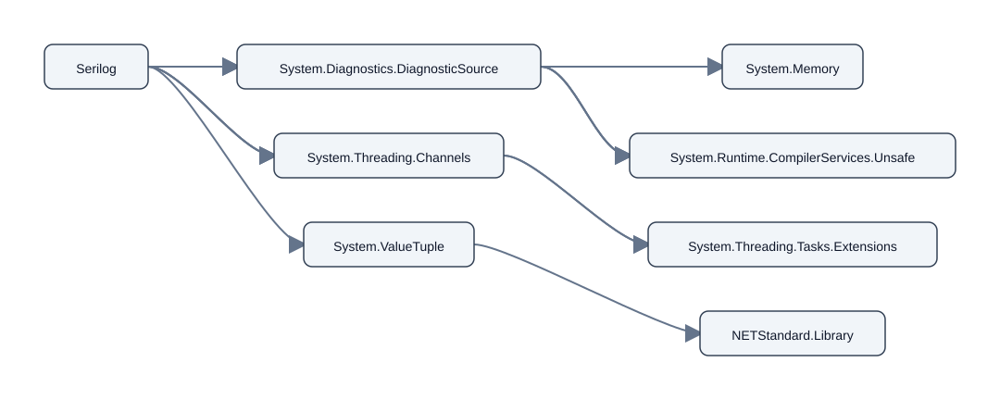
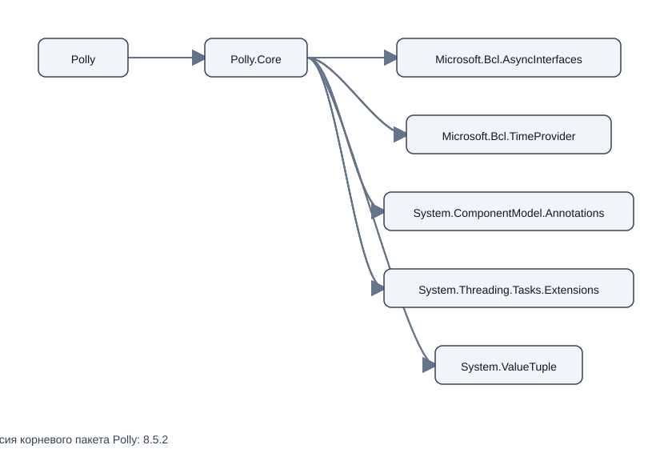
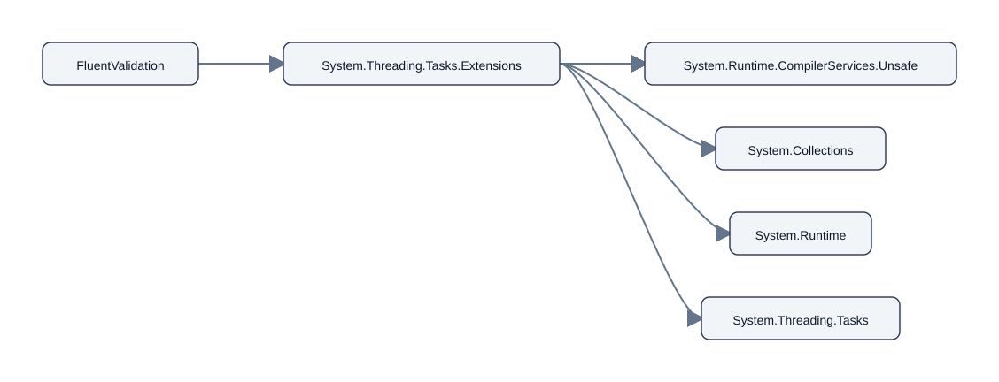

# Практическая работа №2 — конфигурационное управление

Вариант №11. Проект на Python читает YAML-конфигурацию, вручную получает
прямые зависимости NuGet из `.nuspec`, строит рекурсивный обход в ширину (BFS),
ищет обратные зависимости и сохраняет граф в Mermaid и SVG. ASCII-дерево
выводится по настройке `ascii_tree`.

## Требования и ограничения

Нужны Python 3.10+ и PyYAML (`python3 -m pip install PyYAML`). Программа
обращается к NuGet V3 через стандартные HTTP-инструменты Python, скачивает
`.nupkg`, распаковывает ZIP и читает `.nuspec` через `xml.etree.ElementTree`.
NuGet CLI/SDK, `dotnet`, GitHub и готовые средства разрешения графа
зависимостей не используются для получения списка зависимостей.

Выбор версии намеренно упрощён: для точной версии берётся она сама, для
диапазона — включённая нижняя граница, иначе включённая верхняя. Открытые
диапазоны и диапазоны без включённой конкретной границы завершаются ошибкой.
Это не полноценное разрешение NuGet version ranges: код не проверяет
совместимость с target framework, наличие выбранной версии и конфликты версий.
Кроме того, зависимости из разных групп `.nuspec` объединяются; они могут
отличаться от группы, выбранной для конкретного проекта.

## Конфигурация и аргументы

По умолчанию используется `config/config.yaml`; путь можно заменить через
`--config PATH`. Все восемь YAML-ключей обязательны:

| Ключ | Назначение |
| --- | --- |
| `package_name` | ID корневого NuGet-пакета или тестового узла |
| `repository` | URL индекса NuGet V3; в test mode — путь к JSON-графу |
| `test_mode` | `true` читает локальный граф, `false` использует NuGet V3 |
| `version` | версия корневого пакета; в test mode зависимости получают `1.0.0` |
| `output_file` | путь для SVG; рядом сохраняется Mermaid `.mmd` |
| `ascii_tree` | выводить ASCII-дерево (`true`/`false`) |
| `max_depth` | максимальная глубина BFS; корень имеет глубину 0 |
| `filter` | исключать зависимость, если имя содержит эту подстроку без учёта регистра |

Поддерживаемые CLI-параметры:

| Параметр | Назначение |
| --- | --- |
| `--config PATH` | выбрать YAML-файл |
| `--package ID` | заменить корневой пакет из YAML |
| `--version VERSION` | заменить версию корневого пакета из YAML |
| `--output PATH` | заменить путь к SVG (Mermaid сохраняется рядом) |
| `--reverse-dependencies PACKAGE` | вывести обратные рёбра для пакета, найденного в построенном графе |

Параметры версии, режима, глубины и фильтра задаются в YAML. Программа
проверяет наличие ключей и типы значений до построения графа.

## Устройство программы

### `src/main.py`

- `GraphState` хранит граф, множество посещённых пакетов и FIFO-очередь BFS.
  `DEFAULT_CONFIG`, `REQUIRED_KEYS`, `STRING_KEYS`, `MIN_DEPTH`,
  `TEST_VERSION` и `CAPITAL_PACKAGE` задают значения по умолчанию и правила
  проверки; `DependencyProvider` описывает тип функции поставщика зависимостей.
- `parse_arguments` объявляет CLI-параметры; `read_yaml` загружает YAML через
  `yaml.safe_load`; `require_mapping` проверяет корневой тип конфигурации.
- `validate_required_keys`, `validate_string_fields`,
  `validate_boolean_fields` и `validate_depth` проверяют обязательные поля,
  строки, логические значения и неотрицательную глубину.
- `validate_config` запускает проверки конфигурации, а `load_config` читает и
  возвращает проверенные настройки.
- `read_test_graph` проверяет JSON-граф и имена узлов заглавными латинскими
  буквами; `test_provider` создаёт поставщик соседей для test mode.
- `expand_package` добавляет подходящие рёбра и новые узлы очереди.
  `build_dependency_graph` рекурсивно обрабатывает FIFO-очередь и соблюдает
  глубину, фильтр и множество посещённых узлов.
- `configured_provider` выбирает локальный JSON или NuGet-загрузчик.
  `print_graph` печатает рёбра; `main` связывает конфигурацию, обход, вывод и
  обработку ошибок.
- `reverse_provider` инвертирует рёбра для обратного обхода;
  `build_reverse_dependency_graph` находит прямых и транзитивных зависимых,
  а `print_reverse_graph` показывает результат.
- Вложенная функция `provide` в `test_provider` возвращает зависимости
  локального узла. Вложенная `visit_queue` в `build_dependency_graph`
  рекурсивно обрабатывает узлы в порядке BFS.

### `src/nuget.py`

- `HTTP_TIMEOUT`, `NUPKG_SUFFIX`, `NUSPEC_SUFFIX`, `PACKAGE_BASE_TYPE`,
  `VERSION_PART` и `VERSION_RANGE` задают таймаут, формат пакета и правила
  распознавания ресурсов и спецификаций версий.
- `download_bytes` скачивает ответ NuGet V3; `resource_types` нормализует
  поле типов ресурса; `package_base_address` находит адрес хранилища пакетов.
- `package_url` формирует URL `.nupkg`; `local_name` убирает XML namespace;
  `dependency_entries` извлекает ID и version spec из элементов и групп.
- `parse_nuspec` разбирает прямые зависимости XML; `nuspec_contents` открывает
  `.nupkg` как ZIP и возвращает содержимое `.nuspec`.
- `exact_version` распознаёт точную версию в квадратных скобках;
  `ranged_version` выбирает включённую границу; `select_version` применяет
  упрощённую стратегию к версии или диапазону.
- `get_direct_dependencies` скачивает пакет и читает его `.nuspec`;
  `get_transitive_dependencies` выбирает конкретные версии для следующего
  уровня обхода; `get_dependency_details` дополнительно возвращает исходное
  условие версии для подписи ребра.

### `src/visualization.py`

- `mermaid_source` формирует Mermaid с версией в каждом узле и условием на
  каждом ребре;
  `node_levels` назначает минимальные уровни узлам обходом в ширину.
- `node_width` оценивает ширину SVG-узла; `layout_nodes` размещает узлы
  по колонкам уровней; `edge_svg` рисует стрелку с условием версии.
- `svg_source` создаёт автономное SVG с узлами и рёбрами;
  `write_visualization` сохраняет Mermaid и SVG рядом.
- `ascii_tree` строит дерево и отмечает циклы/повторные узлы;
  `print_ascii_tree` печатает это дерево.
- `MERMAID_HEADER` и `SVG_MARGIN`, `SVG_NODE_HEIGHT`, `SVG_MIN_NODE_WIDTH`,
  `SVG_CHAR_WIDTH`, `SVG_HORIZONTAL_PADDING`, `SVG_HORIZONTAL_GAP`,
  `SVG_VERTICAL_GAP`, `SVG_FONT_SIZE`, `SVG_VERSION_FONT_SIZE`,
  `SVG_CONSTRAINT_FONT_SIZE`, `SVG_CURVE_OFFSET` и
  `SVG_CYCLE_OFFSET` задают формат диаграммы и геометрию SVG.

## Запуск, сборка и тесты

Отдельная компиляция не нужна. Из корня репозитория:

```sh
./run.sh --config config/config.yaml
./run.sh --config config/test_mode.yaml
./run.sh --config config/test_mode.yaml --package C
./run.sh --config config/test_mode.yaml --reverse-dependencies G
python3 -m unittest discover -s tests -v
```

Сетевой режим указан в `config/config.yaml`; `config/test_mode.yaml` и JSON-граф
нужны только для локальной проверки. Тесты используют локальные данные и моки,
сеть им не нужна. Итоговая демонстрация этапа 5 ниже использует реальные NuGet
пакеты, а не тестовый граф.

## Этап 5: реальные NuGet-примеры

В `examples/visualizations/real/` сохранены Mermaid и SVG, созданные запуском
программы с теми же NuGet V3 → `.nupkg` → ZIP → `.nuspec` и собственным BFS.
Для воспроизводимости все три примера ограничены `max_depth: 2`; графы
объединяют зависимости, объявленные в группах `.nuspec`. В каждом узле показаны
имя пакета и выбранная для обхода версия; на каждой стрелке указано исходное
ограничение версии из `.nuspec`. Это тот же смысл подписей, что и в примере
варианта 7: версия относится к узлу, условие — к связи. Каждый SVG имеет
одноимённый `.mmd`:

### Serilog



**Корневой пакет: Serilog 4.2.0.** Исходник: [Mermaid](examples/visualizations/real/serilog_4_2_0.mmd).

### Polly



**Корневой пакет: Polly 8.5.2.** Исходник: [Mermaid](examples/visualizations/real/polly_8_5_2.mmd).

### FluentValidation



**Корневой пакет: FluentValidation 11.11.0.** Исходник: [Mermaid](examples/visualizations/real/fluentvalidation_11_11_0.mmd).

Команды повторного создания примеров (при наличии сетевого доступа к NuGet):

```sh
./run.sh --config config/config.yaml --package Serilog \
  --version 4.2.0 \
  --output examples/visualizations/real/serilog_4_2_0.svg
./run.sh --config config/config.yaml --package Polly \
  --version 8.5.2 \
  --output examples/visualizations/real/polly_8_5_2.svg
./run.sh --config config/config.yaml --package FluentValidation \
  --version 11.11.0 \
  --output examples/visualizations/real/fluentvalidation_11_11_0.svg
```

Команда `--version` задаёт версию корневого пакета без изменения YAML;
ограничение глубины берётся из `config/config.yaml` (`max_depth: 2`).

## Сопоставление с NuGet

Прямые метаданные также сверены с официальными страницами NuGet:
[Serilog 4.2.0](https://www.nuget.org/packages/Serilog/4.2.0),
[Polly 8.5.2](https://www.nuget.org/packages/Polly/8.5.2) и
[FluentValidation 11.11.0](https://www.nuget.org/packages/FluentValidation/11.11.0).
ID пакетов совпадают с данными загруженных `.nuspec`. Страница Serilog
показывает прямые зависимости `System.Diagnostics.DiagnosticSource` и
`System.Threading.Channels` для нескольких групп, а также `System.ValueTuple`
для .NET Framework 4.6.2; группы .NET 6, 8 и 9 dependencies не содержат.
Страница Polly показывает `Polly.Core (>= 8.5.2)` для каждой target framework-группы,
а FluentValidation указывает `System.Threading.Tasks.Extensions (>= 4.5.4)` в
группе .NET Standard 2.0 и отсутствие зависимостей в остальных включённых
группах. Это подтверждает, что пример показывает объединение метаданных разных
framework-групп, а не одну группу, выбранную restore для проекта.

NuGet Package Manager UI показывает пакеты проекта и их разрешённые версии,
а restore выбирает совместимые зависимости с учётом target framework и
конфликтов версий. Поэтому полный проектный граф может отличаться от
объединённого учебного графа. Команды NuGet/dotnet для вычисления списка
зависимостей или графа при выполнении этой работы не используются.
